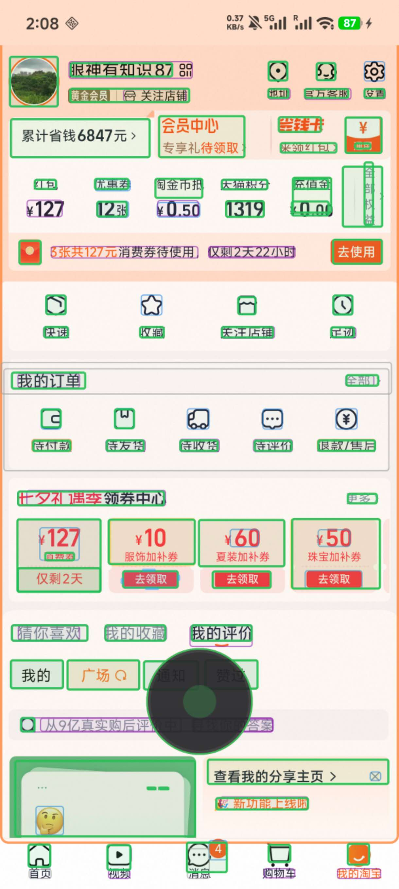
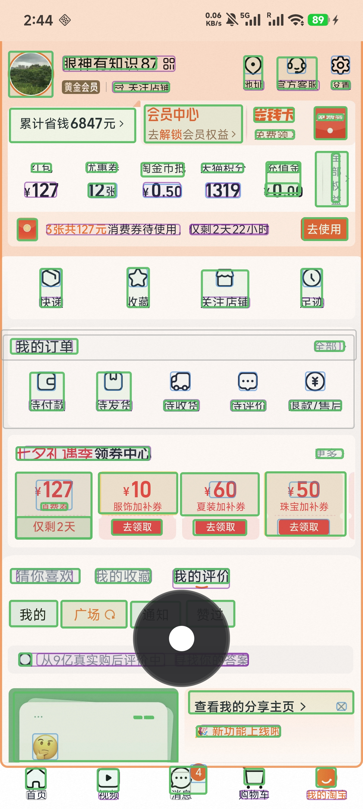

# 2026-08-12 融合引擎重叠消除与图标标签合并 / 重複除去とアイコン・ラベル統合

[中文](#中文) ｜ [日本語](#日本語)

---

## 中文

## 修改背景

OCR 独立快速通道启用后，普通短文字能够立即进入导航图，但也出现了两类重复目标：

1. YOLO 或 Accessibility 已经识别出完整可点击控件，OCR 又在控件内部生成一个文字节点，形成绿框套绿框。
2. 宫格入口的图标与下方说明文字分别成为两个节点，用户需要在两个相邻目标之间重复导航。

本次修改把融合引擎扩展为“结构控件吸收内部标签”和“图标配对下方标签”两类明确关系，在不降低独立动作按钮可达性的前提下减少无效绿框。

## 实机效果对比

| 修改前 | 修改后 |
| --- | --- |
|  |  |

修改后的实机画面中，`地址`、`官方客服`、`设置`、`快递`、`收藏`、`关注店铺`、`足迹`等入口已经形成覆盖“图标＋文字”的单一导航框。部分只停留在 YOLO 证据层的图标仍不会参与最终配对，因此当前版本以稳定性和避免误合并为优先，没有继续放宽规则。

调试框颜色含义：

- 绿色：最终可导航节点。
- 蓝色：YOLO 结构证据。
- 紫色：OCR 文字证据。

蓝色或紫色证据框在融合后仍可显示，它们用于调试，不一定代表导航图中仍存在独立节点。

## 核心修改

### 1. 完整控件吸收内部 OCR 标签

- 当 OCR 短文字至少 78% 位于可靠的 YOLO 或 Accessibility 结构框内时，将其作为控件标签吸收。
- 融合节点沿用外层结构范围、点击方式和稳定 ID，并使用 OCR 文字补充名称。
- 同一结构框包含多个 OCR 片段时，优先选择靠上、靠左、非数字且语义完整的短文本。
- 大卡片和整行中的“领取”“去使用”“关闭”等独立动作继续保留，避免为了减少绿框而损失精确操作入口。

### 2. 图标与下方标签一对一合并

- 可靠图标与紧邻下方的短文字使用双向最近匹配。
- 只有图标和标签互为最佳候选时才允许合并，防止同一排入口发生跨列或链式合并。
- 合并后的显示范围覆盖图标与文字，节点角色统一为 `ICON_ENTRY`，名称来自 OCR 标签。
- 价格、时间、纯数字、长句和动态文字不参加配对。

### 3. 显示范围与点击范围分离

- 为导航节点增加内部 `interactionBounds`。
- `bounds` 负责绿框显示、焦点导航和方向计算。
- `interactionBounds` 负责 Accessibility 节点查找和手势点击。
- 图标标签合并后虽然显示整个“图标＋文字”，实际点击仍落在原始图标或可靠结构框内。

### 4. 稳定 ID 收敛与焦点迁移

- 融合结果记录被吸收的 DIRECT 节点稳定 ID。
- FUSED 更新到达时，一次性移除被吸收的 OCR/YOLO 节点，不再额外保留一帧。
- 建立旧稳定 ID 到融合节点的别名；焦点原本位于文字标签上时，会迁移到新的合并节点。
- 未被明确吸收的 OCR 和 YOLO 快速通道节点仍按原有非破坏规则保留。

### 5. 融合关系和诊断信息

新增以下内部融合关系：

- `OVERLAP_DUPLICATE`
- `CONTAINED_LABEL`
- `ICON_LABEL_PAIR`
- `KEEP_INNER_ACTION`

运行日志会分别统计包含标签合并、图标标签配对、独立动作保留和普通重叠合并的数量，便于后续实机调优。

## 验证结果

- 编译生产代码与单元测试代码通过。
- `testDebugUnitTest`：60 项测试全部通过，无失败或跳过。
- `assembleDebug`：构建成功。
- Redmi K70 Ultra 覆盖安装成功，应用冷启动正常。
- 淘宝实机页面验证显示合并数量明显减少，当前效果已满足日常使用要求。

## 当前边界

部分 YOLO 检测结果只属于结构证据，并未升级为可参与融合的导航候选。这类图标可能仍显示蓝框，而其下方 OCR 文字单独显示绿色导航框。当前版本暂不把所有证据级图标升级，以避免扩大误合并范围；后续如继续优化，可采用“只有与合格 OCR 标签完成严格一对一配对时才升级”的策略。

---

## 日本語

### 変更の背景

OCR の独立高速経路を有効にしたことで、一般的な短いテキストを即座にナビゲーショングラフへ追加できるようになりました。一方で、次の二種類の重複ターゲットが発生していました。

1. YOLO または Accessibility がクリック可能なコントロール全体を検出した後、その内部テキストを OCR が別ノードとして追加し、緑色の枠が二重に表示される。
2. グリッド型メニューのアイコンと、その直下にある説明ラベルが別々のノードになり、隣接する二つのターゲット間を重複して移動する必要がある。

今回の変更では、融合エンジンに「構造コントロールによる内部ラベルの吸収」と「アイコンと直下ラベルのペアリング」という二つの明確な関係を追加しました。独立した操作ボタンへの到達性を維持しながら、不要な緑色の枠を削減します。

### 実機での比較

| 変更前 | 変更後 |
| --- | --- |
|  |  |

変更後の実機画面では、`地址`、`官方客服`、`设置`、`快递`、`收藏`、`关注店铺`、`足迹` などの項目が、「アイコン＋テキスト」を覆う一つのナビゲーション枠に統合されています。一部のアイコンは YOLO の証拠レイヤーにのみ存在し、最終候補へ昇格していないため、現在のバージョンでは誤統合を避けることと安定性を優先し、判定条件をこれ以上緩和していません。

デバッグ枠の色は次の意味を持ちます。

- 緑：最終的なナビゲーションノード。
- 青：YOLO の構造証拠。
- 紫：OCR のテキスト証拠。

融合後も青または紫の証拠枠が表示される場合があります。これらはデバッグ用であり、ナビゲーショングラフ内に独立ノードが残っていることを必ずしも意味しません。

### 主な変更点

#### 1. 完全なコントロールによる内部 OCR ラベルの吸収

- OCR の短いテキスト領域の 78% 以上が、信頼できる YOLO または Accessibility の構造枠内に含まれる場合、そのテキストをコントロールのラベルとして吸収します。
- 融合後のノードは外側の構造範囲、クリック方式、安定 ID を継承し、表示名には OCR テキストを使用します。
- 一つの構造枠に複数の OCR 断片が含まれる場合、上側、左側、数字以外、意味が完結している短いテキストを優先します。
- 大きなカードや行全体に含まれる「领取」「去使用」「关闭」などの独立操作は残し、枠を減らすために正確な操作入口を失わないようにします。

#### 2. アイコンと直下ラベルの一対一統合

- 信頼できるアイコンと、そのすぐ下にある短いテキストを双方向最近傍で照合します。
- アイコンとラベルが互いに最良候補である場合にだけ統合し、同じ行での列またぎや連鎖的な誤統合を防ぎます。
- 統合後の表示範囲はアイコンとテキストの両方を覆い、ノードの役割は `ICON_ENTRY`、名称は OCR ラベルを使用します。
- 価格、時刻、数字のみの文字列、長文、動的テキストはペアリング対象外です。

#### 3. 表示範囲とクリック範囲の分離

- ナビゲーションノードに内部フィールド `interactionBounds` を追加しました。
- `bounds` は緑枠の表示、フォーカス移動、方向計算に使用します。
- `interactionBounds` は Accessibility ノードの検索とジェスチャークリックに使用します。
- アイコンとラベルの統合後も、実際のクリック位置は元のアイコンまたは信頼できる構造枠内に維持されます。

#### 4. 安定 ID の収束とフォーカス移行

- 融合結果に、吸収された DIRECT ノードの安定 ID を記録します。
- FUSED 更新の到着時に、吸収済みの OCR/YOLO ノードを一括で削除し、余分な一フレームを残しません。
- 旧安定 ID から融合ノードへのエイリアスを作成し、フォーカスがテキストラベル上にあった場合は新しい融合ノードへ移行します。
- 明示的に吸収されていない OCR/YOLO 高速経路ノードは、従来の非破壊ルールに従って保持します。

#### 5. 融合関係と診断情報

次の内部融合関係を追加しました。

- `OVERLAP_DUPLICATE`
- `CONTAINED_LABEL`
- `ICON_LABEL_PAIR`
- `KEEP_INNER_ACTION`

実行ログでは、包含ラベル統合、アイコン・ラベル統合、独立操作の保持、通常の重複統合を個別に集計し、今後の実機調整に利用できます。

### 検証結果

- 本番コードとユニットテストコードのコンパイルに成功。
- `testDebugUnitTest`：全 60 テスト成功。失敗およびスキップなし。
- `assembleDebug`：ビルド成功。
- Redmi K70 Ultra への上書きインストールに成功し、アプリのコールドスタートも正常。
- 淘宝の実機画面で重複枠が明確に減少し、現在の結果が日常利用の要件を満たすことを確認。

### 現在の制限

一部の YOLO 検出結果は構造証拠としてのみ扱われ、融合に参加できるナビゲーション候補へ昇格していません。この場合、アイコンには青い枠が表示され、直下の OCR テキストだけが緑色のナビゲーション枠になることがあります。誤統合の増加を避けるため、現在のバージョンではすべての証拠レベルのアイコンを昇格させていません。今後さらに改善する場合は、「条件を満たす OCR ラベルと厳密な一対一ペアが成立した場合だけ昇格する」方式を採用できます。
